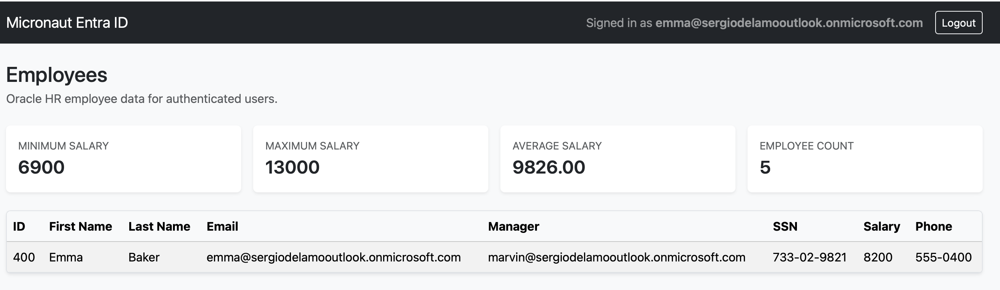

This project is a [Pyronaut](https://micronaut-projects.github.io/pyronaut/latest/guide/) (Python on Micronaut) demo of the [Configure Oracle Deep Data Security Sample Application](https://docs.oracle.com/en/database/oracle/oracle-database/26/ddscg/configure-oracle-deep-data-security-sample-application.html). It is a port of the Java [micronaut-deep-data-security-demo](https://github.com/sdelamo/micronaut-deep-data-security-demo).

## Setup

Rename `.env.example` to `.env`. For example:

`mv .env.example .env`

### Entra ID

Setup your Entra ID applications as described here [Create Application Registrations in Microsoft Entra ID](https://docs.oracle.com/en/database/oracle/oracle-database/26/ddscg/create-application-registrations-microsoft-entra-id-springboot.html#GUID-110CF776-84CB-4778-8988-1EDFAA9094B0).

You will obtain: `[TENANT_ID]`, `[DB_APP_ID_URI]`, `[EMP_RECORDS_APP_ID]`, `[CLIENT_SECRET]`, and `[DB_APP_ID_URI]`. Replace
those placeholders in `.env` with the real values.

### Oracle Database

#### Run Oracle Database via Docker

```
docker run -d --name micronaut-deep-data-security -p 1521:1521 -p 2484:2484 -e ORACLE_PASSWORD='YourStrongPassword1' -v oracle-free-data:/opt/oracle/oradata gvenzl/oracle-free:23.26.2-full
```

It is important to expose both ports 1521 and 2484. Also, use the `23.26.2-full` as previous versions don't support Deep Data Security.

#### Generate Wallets and Certificates

Generate the [Wallets and Certificates](https://docs.oracle.com/en/database/oracle/oracle-database/26/ddscg/generate-wallets-and-certificates-springboot.html) as described in the tutorial in the [Oracle Deep Data Security Guide](https://docs.oracle.com/en/database/oracle/oracle-database/26/ddscg/generate-wallets-and-certificates-springboot.html). We are running Oracle Database within a container. Thus, instead of creating them in `/u01/app/oracle/wallets/server`, we will create them in `$HOME/wallets/server` -  `/opt/oracle/wallets/server`

1. Connect to the container:

```
docker exec -it micronaut-deep-data-security bash
```

2. Create a directory for the server wallet.

```
mkdir -p $HOME/wallets/server
```

Create the server wallet (identity) and a self-signed certificate.

```
orapki wallet create -wallet /u01/app/oracle/wallets/server -pwd <wallet_password> -auto_login
orapki wallet add -wallet /u01/app/oracle/wallets/server -dn "CN=<your-vm-fqdn>,O=Oracle,C=US" -keysize 2048 -self_signed -validity 3650 -pwd <wallet_password>
```

For this demo, instead of `<your-vm-fqdn>`, we use `localhost`.

Enter the `<wallet_password>`. For example, use `WalletPass123!` instead of `<wallet_password>`.

#### Copy the wallets to the host

Copy the wallets to the host machine

```
docker cp micronaut-deep-data-security:/opt/oracle/wallets /Users/sdelamo/oracle-wallets/
```

Edit `.env` and set the `ORACLE_WALLET_TRUSTSTORE` to the folder in your computer.

For example:

```
ORACLE_WALLET_TRUSTSTORE='/Users/sdelamo/oracle-wallets/server/cwallet.sso'
```

#### Configure Database Network Settings

[Configure the database listener and network layer](https://docs.oracle.com/en/database/oracle/oracle-database/26/ddscg/configure-database-network-settings.html) to accept secure TCPS connections on port 2484 and enable token-based authentication. Both configurations use the server wallet you created in the previous section.

Connect to the container:

```
docker exec -it micronaut-deep-data-security bash
```

1. Configure the database listener.

a. Go to the database network configuration directory.

```
cd $ORACLE_HOME/network/admin
```

b. Open `listener.ora` in a text editor.

Add or update the wallet location and the TCPS address as shown below and save the file.
Use the database server's fully qualified domain name for HOST. For this demo, I used `0.0.0.0`

```
WALLET_LOCATION = (SOURCE = (METHOD = FILE) (METHOD_DATA = (DIRECTORY = /opt/oracle/wallets/server)))

TLS_CLIENT_AUTHENTICATION = FALSE

LISTENER =
 (DESCRIPTION_LIST =
  (DESCRIPTION =
   (ADDRESS = (PROTOCOL = IPC)(KEY = EXTPROC_FOR_FREE))
   (ADDRESS = (PROTOCOL = TCP)(HOST = 0.0.0.0)(PORT = 1521))
   (ADDRESS = (PROTOCOL = TCPS)(HOST = 0.0.0.0)(PORT = 2484))
  )
 )

DEFAULT_SERVICE_LISTENER = FREE
```

2. Configure network and token authentication (`sqlnet.ora`).
   This step enables token-based authentication and directs the database network layer to the server wallet for TLS.
   In $ORACLE_HOME/network/admin, open sqlnet.ora.

```
NAMES.DIRECTORY_PATH = (EZCONNECT, TNSNAMES)
# See https://github.com/gvenzl/oci-oracle-xe/issues/43
DISABLE_OOB=ON
BREAK_POLL_SKIP=1000

# --- Authentication ---
SQLNET.AUTHENTICATION_SERVICES = (BEQ, TOKENAUTH)

# --- TLS Configuration ---
TLS_CLIENT_AUTHENTICATION = FALSE
TLS_SERVER_DN_MATCH = TRUE

# Prevents conflicts between Native Encryption and TLS
SQLNET.IGNORE_ANO_ENCRYPTION_FOR_TCPS = TRUE

WALLET_LOCATION = (SOURCE = (METHOD = FILE) (METHOD_DATA = (DIRECTORY = /opt/oracle/wallets/server)))
```

After doing these changes, within the container do:

```
sqlplus / as sysdba
```
```
ALTER SYSTEM REGISTER;
```
Oracle documents that as the way to force service registration after the listener starts.

Then, check the output with `lsnrctl status`.

#### Configure Data Access Control

[Configure Data Access Control](https://docs.oracle.com/en/database/oracle/oracle-database/26/ddscg/configure-data-access-control-sb.html) as described here.

### Setup Pyronaut Application

This demo requires Pyronaut 0.1.0 (Micronaut platform 5.2.1) and a container runtime for the tests.

Dependencies are JVM coordinates declared in `pyproject.toml`, under `[tool.pyronaut.dependencies]`, instead of a Gradle build file. Run `pyronaut install` after changing them.

#### Micronaut Security OJDBC Extensions

The application has a dependency to [Micronaut Security OJDBC Extensions](https://micronaut-projects.github.io/micronaut-security/latest/guide/#ojdbcExtensionsInstallation), which needs an HTTP client implementation:

```toml
"io.micronaut.security:micronaut-security-ojdbc-extensions",
"io.micronaut:micronaut-http-client",
```

#### Azure Token Provider for JDBC

The application contains an Azure token provider for JDBC (authenticates the connection pool to Oracle via Entra ID):

```toml
"com.oracle.database.jdbc:ojdbc-provider-azure:1.1.0",
"com.azure:azure-core-http-jdk-httpclient",
```

The Azure SDK's Netty-based HTTP client is excluded globally, so that it does not clash with the Netty shipped by Micronaut:

```toml
exclusions = [
    "com.azure:azure-core-http-netty",
]
```

#### Oracle Wallet/SSL Support

The application contains Oracle Wallet/SSL support (reads cwallet.sso for TCPS certificate validation):

```toml
"com.oracle.database.security:oraclepki:23.26.3.0.0",
```

#### Micronaut Data JDBC Dependencies

The application contains the following dependencies for Micronaut Data JDBC:

```toml
# runtime
"io.micronaut.data:micronaut-data-jdbc",
# build
"io.micronaut.data:micronaut-data-processor",
```

#### Hikari Connection Pool

The application contains the following dependency for the Hikari Connection Pool:

```toml
"io.micronaut.sql:micronaut-jdbc-hikari",
```

#### Oracle Database Driver

The application contains the following dependency for the Oracle Database Driver:

```toml
"com.oracle.database.jdbc:ojdbc11",
```

#### Configuration

Check `config/application-dev.toml` for the configuration of OJDBC Extensions, Datasource, and security configuration. It is loaded in the `dev` environment, which `pyronaut dev` activates. Every secret is a `${...}` placeholder resolved from the environment; see `.env.example`.

#### Privilege Escalation

See `src/example/repository.py` for Privilege Escalation with the `RunAs` annotation:

```python
@JdbcRepository(dialect=Dialect.ORACLE)
class EmployeeRepository(CrudRepository[EmployeeEntity, Long], Protocol):

    @RunAs("ORACLE_DATA_ROLE_COMPENSATION_ANALYST")
    @Query("SELECT MIN(salary) AS min, MAX(salary) AS max, SUM(salary) AS sum, COUNT(*) AS count FROM hr.employees")
    def getSalaryAggregates(self) -> SalaryAggregates: ...
```

`@RunAs` adds the `ORACLE_DATA_ROLE_COMPENSATION_ANALYST` role to the signed-in user's authentication for the duration of the call. The OJDBC extension turns every role with the `ORACLE_DATA_ROLE_` prefix into an Oracle `DATA ROLE` in the End User Security Context it hands to Oracle JDBC, so the aggregate query runs as `COMPENSATION_ANALYST` whoever is signed in.

## Project layout

- `src/example/domain.py`: the `EmployeeEntity` dataclass mapped to `hr.employees`.
- `src/example/dto.py`: `EmployeeDto`, `SalaryAggregates` and `SalarySummaryDto` dataclasses.
- `src/example/repository.py`: the `EmployeeRepository` Micronaut Data JDBC repository.
- `src/example/services.py`: `EmployeeService`, which builds the home page model.
- `src/example/home.py`: the `/` route, rendered by the Thymeleaf template in `config/views/home.html`.
- `src/main.py`: logging configuration (the equivalent of `logback.xml`).
- `tests/`: pytest tests. Oracle Database Free is started with Testcontainers; `tests-config/oracle-init.sql` creates the `hr` schema and `tests-config/employees-test-data.sql` loads the sample employees.

## Run the App

```
set -a; source .env; set +a
pyronaut dev
```

`pyronaut dev` activates the `dev` environment. Alternatively, run `MICRONAUT_ENVIRONMENTS=dev pyronaut run`.

Visit [http://localhost:3000](http://localhost:3000) and you will see:



## Run the tests

```
pyronaut test
```

The tests need Docker (or another container runtime supported by Testcontainers) to start `gvenzl/oracle-free`.
